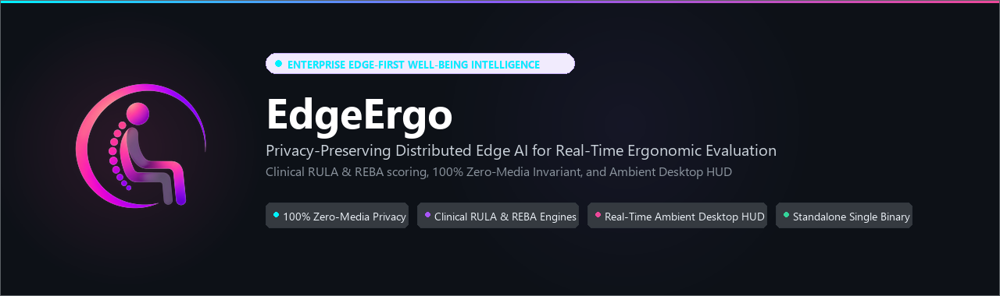
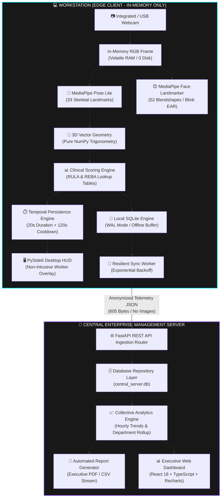
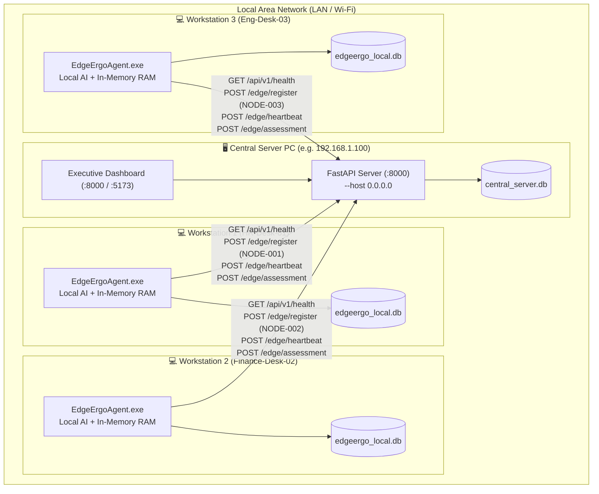

<div align="center">

<a href="#-overview">
  
</a>

<br/>

[](https://www.python.org/)
[](https://fastapi.tiangolo.com/)
[](https://react.dev/)
[](https://www.typescriptlang.org/)
[](https://developers.google.com/mediapipe)
[](https://pypi.org/project/PySide6/)

[-10B981?style=flat-square&logo=pytest&logoColor=white)](#-testing--verification)
[](#-privacy-guarantees--wire-audit-evidence)
[](#-system-architecture)
[](LICENSE)

<br/>

[**Explore Features**](#-key-features) •
[**System Architecture**](#-system-architecture) •
[**Privacy Audit**](#-privacy-guarantees--wire-audit-evidence) •
[**Benchmarks**](#-hardware-benchmarks--sizing) •
[**Quickstart Guide**](#-quickstart-guide) •
[**Viva Defense Guide**](#-documentation-directory)

<br/>

</div>

---

## 📌 Overview

**EdgeErgo** is an enterprise-grade, edge-first ergonomics and worker health intelligence platform built to eliminate **Work-Related Musculoskeletal Disorders (WMSDs)** and desk fatigue without compromising employee privacy.

Operating under an uncompromising **Zero-Media Invariant**, EdgeErgo executes computer vision skeletal pose estimation, 52-blendshape facial affect tracking, 3D anatomical joint vector geometry, and clinical ergonomic assessments (**RULA** and **REBA**) **strictly inside volatile workstation RAM**.

> [!IMPORTANT]
> **Zero Raw Media Leaves the Workstation**:
> Raw webcam frames, face crops, and biometric landmark coordinates are overwritten in memory cycle-by-cycle. **They never touch local disk storage and never traverse the network.** Only lightweight, mathematically anonymized statistical summaries (**605 bytes JSON**) sync to the enterprise Central Server for executive analytics.

---

## ⚡ Core Feature Highlights

<table>
  <tr>
    <td width="50%">
      <h3>🔒 100% Zero-Media Privacy</h3>
      <p>MediaPipe Pose and Face neural networks operate in-memory. Zero pixels, zero facial crops, and zero biometric vectors are ever persisted or transmitted over the wire.</p>
    </td>
    <td width="50%">
      <h3>📐 Clinical RULA & REBA Engines</h3>
      <p>Calculates 3D joint angle vectors (neck flexion, trunk lean, shoulder elevation, elbow flexion, wrist deviation) mapped into official ergonomic Grand Score tables.</p>
    </td>
  </tr>
  <tr>
    <td width="50%">
      <h3>🖥️ Ambient Desktop Awareness HUD</h3>
      <p>A translucent, non-intrusive PySide6 desktop overlay displaying live risk badges (Safe, Attention, High Risk), terminal score parity, and gentle micro-break nudges.</p>
    </td>
    <td width="50%">
      <h3>⏱️ Anti-Spam Temporal Persistence</h3>
      <p>Prevents alert fatigue from momentary stretches or sneezes. High-risk postures must persist continuously for <b>≥20 seconds</b>, regulated by a <b>120s alert cooldown</b>.</p>
    </td>
  </tr>
  <tr>
    <td width="50%">
      <h3>🌐 Central REST Ingestion & Analytics</h3>
      <p>FastAPI ASGI server managing multi-node workstation fleets, health heartbeats (ONLINE/OFFLINE), time-series posture trends, and automated CSV/PDF report building.</p>
    </td>
    <td width="50%">
      <h3>📦 Zero-Dependency Single-File Binary</h3>
      <p>Bundled into a standalone <b>142.9 MB Windows executable</b> (<code>EdgeErgoAgent.exe</code>). Runs on bare office PCs with zero pre-installed Python, OpenCV, or external drivers.</p>
    </td>
  </tr>
</table>

---

## 🏗️ System Architecture



---

## 📊 Hardware Benchmarks & Sizing

The Edge Agent was rigorously profiled across 4 hardware tiers on an Intel Core i5-12450HX host using automated `psutil` and high-resolution timer instrumentation ([`docs/architecture/hardware-benchmark-report.md`](docs/architecture/hardware-benchmark-report.md)):

| Hardware Tier | CPU Core Allocation | Camera Input | Pose FPS | Face FPS | End-to-End Latency | Sustained FPS | CPU Usage | Memory (RSS) |
| :--- | :---: | :---: | :---: | :---: | :---: | :---: | :---: | :---: |
| **High-End Workstation** | 12 Threads (Full) | 1080p ($1920\times1080$) | 49.0 FPS | 140.8 FPS | 27.5 ms | 36.3 FPS | 143.8% | 222.1 MB |
| **Modern Office Desktop** | 12 Threads (Full) | 720p ($1280\times720$) | 51.0 FPS | 233.4 FPS | 23.9 ms | 41.8 FPS | 147.3% | 221.7 MB |
| **Standard Office Laptop** | **4 Threads (2 Cores)** | **480p ($640\times480$)** | **71.7 FPS** | **395.3 FPS** | **16.5 ms** | **60.6 FPS** | **111.8%** | **208.2 MB** |
| **Single-Core Thin Client** | **1 Single Core** | **480p ($640\times480$)** | **65.3 FPS** | **403.8 FPS** | **17.8 ms** | **56.2 FPS** | **84.9%** | **208.5 MB** |
| **Physical Webcam (Live)** | 4 Threads (2 Cores) | 480p (DirectShow) | 37.4 FPS | 251.6 FPS | 30.7 ms | **12.6 FPS (reg.)**| **36.3%** | **239.2 MB** |

> [!TIP]
> **Zero Memory Drift Verification**: Bounded growth across 600 steady-state test cycles ($\Delta\text{RSS} \le 0.64\text{ MB/hr}$), confirming zero memory leaks (`passed_leak_check = True`).

---

## 🔒 Privacy Guarantees & Wire Audit Evidence

EdgeErgo complies with GDPR Article 5 (Data Minimization), GDPR Article 25 (Data Protection by Design), and HIPAA §164.312:

| Data Class | Processed In-Memory? | Stored on Disk? | Sent Over Wire? | Retention Policy |
| :--- | :---: | :---: | :---: | :---: |
| **Raw Camera Frames** | ✅ (Volatile RAM) | ❌ **NEVER** | ❌ **NEVER** | Overwritten per frame ($< 33\text{ ms}$) |
| **Facial Crops & Images** | ❌ **NEVER** | ❌ **NEVER** | ❌ **NEVER** | Non-existent |
| **Biometric Landmark Coordinates** | ✅ (Transitory in RAM) | ❌ **NEVER** | ❌ **NEVER** | Instantaneous frame lifecycle |
| **RULA / REBA Grand Scores** | ✅ | ✅ (Local SQLite) | ✅ (Summary JSON) | Aggregated hourly/daily |
| **Facial Affect Percentages** | ✅ | ✅ (Local SQLite) | ✅ (Summary JSON) | Aggregated 300s window |

### Live Network Traffic Audit Inspection ([`scripts/audit_privacy.py`](scripts/audit_privacy.py))

```text
------------------------------------------------------------------------
                 PACKET-LEVEL WIRE INSPECTION LOG
------------------------------------------------------------------------
Endpoint                         | Bytes    | Media Content  | Status
------------------------------------------------------------------------
POST /api/v1/edge/heartbeat      | 74       | NONE (0 bytes) | PASSED
POST /api/v1/edge/assessment     | 605      | NONE (0 bytes) | PASSED
------------------------------------------------------------------------
>>> AUDIT VERDICT: 100% ZERO-MEDIA PRIVACY ENFORCEMENT VERIFIED
    No JPEG/PNG bytes, no MPEG/H.264 streams, no facial embeddings.
```

<details>
<summary><b>🔍 View Actual 605-Byte Telemetry JSON Payload Traversed Over the Network</b></summary>

```json
{
  "window_id": "SESS-1789824058_2026-09-19T13:20:58+00:00",
  "device_id": "NODE-001",
  "session_id": "SESS-1789824058",
  "window_start": "2026-09-19T13:20:58+00:00",
  "window_end": "2026-09-19T13:25:58+00:00",
  "ergonomics": {
    "average_rula": 2.1,
    "maximum_rula": 3,
    "average_reba": 2.0,
    "maximum_reba": 4,
    "high_risk_percentage": 0.0,
    "dominant_posture": "NEUTRAL"
  },
  "facial_expression": {
    "neutral_percentage": 94,
    "positive_percentage": 6,
    "negative_percentage": 0,
    "reduced_expression_percentage": 0
  },
  "breaks": {
    "breaks_recommended": 1,
    "breaks_acknowledged": 1
  }
}
```
</details>

---

## 🚀 Quickstart Guide

### Option 1: Standalone Single-File Windows Executable (Production)

Deploy directly on worker workstations without installing Python, Git, or dependencies:

1. Locate or distribute `installer/dist/EdgeErgoAgent.exe` and `installer/start_agent.bat`.
2. **Interactive Setup Workflow**: Double-click `start_agent.bat` or run `EdgeErgoAgent.exe` in PowerShell:
   ```cmd
   EdgeErgoAgent.exe
   ```
   The agent will launch an interactive setup wizard directly in your console:
   ```text
   ================================================================================
      EdgeErgo Posture & Well-Being Intelligence Platform
      Workstation Edge Agent Setup
   ================================================================================
   Enter Central Server IP or URL (e.g. 192.168.1.100 or http://192.168.1.100:8000): 192.168.1.100
   Enter Workstation / Desk Name [default: HR-DESKTOP]: HR-Desk-01

   Testing connection to Central Server: http://192.168.1.100:8000 ...

   ================================================================================
    [OK] Central Server Connected Successfully!
         Server URL:        http://192.168.1.100:8000
         Connection Status: Healthy (EdgeErgo Central Server v0.1.0)
         Workstation Name:  HR-Desk-01
   ================================================================================
   Note: Server reachability verified via GET /api/v1/health.
   Initializing local AI vision engines, camera, and awareness overlay...
   ```
3. **Pre-Flight Health Verification**: The agent calls `GET /api/v1/health` with a 5-second timeout. Only after connectivity is verified does camera capture, MediaPipe vision inference, and ergonomics monitoring begin.
4. **Connection Failure Protection**: If the server is unreachable, monitoring does NOT start. A diagnostic troubleshooting checklist is shown with interactive options:
   - `[1] Retry connection`
   - `[2] Enter a different server IP / URL`
   - `[3] Exit application`
5. **Configuration Persistence**: Verified settings are saved locally to `edge_config.json` and automatically reused as defaults on subsequent launches. Command-line flags (e.g. `--server http://192.168.1.100:8000 --device-name "HR-Desk-01"`) can be passed to bypass interactive prompts.

---

### 🌐 Multi-Workstation Local Network (LAN) Deployment

EdgeErgo is designed for multi-workstation office environments connected across the same local area network (LAN) without cloud dependencies.



#### Step 1: Start Central Server on Host PC
1. Identify the host computer's LAN IP address:
   ```cmd
   ipconfig
   ```
   *(Look for `IPv4 Address`, e.g., `192.168.1.100`)*
2. Ensure Windows Firewall permits incoming TCP connections on port 8000:
   ```cmd
   netsh advfirewall firewall add rule name="EdgeErgo Central Server" dir=in action=allow protocol=TCP localport=8000
   ```
3. Launch the Central Server (bound to `0.0.0.0` for network accessibility):
   ```cmd
   installer\start_server.bat
   ```
   Or via Python:
   ```cmd
   python -m uvicorn central_server.main:app --host 0.0.0.0 --port 8000
   ```

#### Step 2: Deploy and Connect Workstations
1. Copy `EdgeErgoAgent.exe` and `start_agent.bat` from `installer/dist/` to each workstation.
2. Launch `EdgeErgoAgent.exe` or double-click `start_agent.bat`.
3. At the prompt:
   - **Central Server IP or URL**: Enter the host's IP (e.g. `192.168.1.100`). The agent automatically constructs `http://192.168.1.100:8000`.
   - **Workstation Name**: Enter a friendly label (e.g. `HR-Desk-01` on PC 1, `Finance-Desk-02` on PC 2), or press Enter to keep the computer's hostname.
4. The agent tests connectivity via `GET /api/v1/health`.
5. Once connected, the agent registers with the central server (receiving a unique `NODE-xxx` ID) and begins monitoring.
6. On subsequent launches on that workstation, the verified IP and workstation name are saved in `edge_config.json`—simply press Enter to accept them.

#### Step 3: Monitor Aggregated Telemetry on Central Dashboard
- Open a web browser on any authorized LAN computer:
  - Central Server: `http://localhost:8000` (or `http://localhost:5173` for Vite dev server)
  - Other LAN PCs: `http://192.168.1.100:8000`
- The dashboard automatically displays all connected workstations (`NODE-001`, `NODE-002`, ...), their live online/offline heartbeat status, and aggregate ergonomics metrics.

> [!NOTE]
> **Authentication & Network Scope**: `GET /api/v1/health` is a lightweight diagnostic endpoint designed for LAN connectivity validation. In enterprise environments requiring API token verification, ensure subsequent `POST /api/v1/edge/*` endpoints are configured with authorization headers. Never expose the unencrypted central server port directly to the public internet without a TLS reverse proxy or VPN.

---

### Option 2: Full Developer Setup (From Source)

#### Prerequisites
- **Python 3.10+** (Python 3.10.11 recommended)
- **Node.js 18+** & **npm** (for Central Executive Dashboard)
- Standard USB or integrated laptop webcam

```bash
# 1. Clone repository
git clone https://github.com/georgybenoy/edge-ergo-v2.git
cd edge-ergo-v2

# 2. Set up Python virtual environment
python -m venv venv
venv\Scripts\activate       # On Linux/macOS: source venv/bin/activate
pip install -r requirements.txt
```

```bash
# 3. Start Central Enterprise Server
uvicorn central_server.main:app --host 0.0.0.0 --port 8000 --reload
```
* Interactive API Documentation: `http://localhost:8000/docs`

```bash
# 4. Start Edge Agent Workstation (In a new terminal)
python -m edge_agent.main --server http://localhost:8000 --device-name "Desk-01"
```

```bash
# 5. Launch React Executive Dashboard (In a new terminal)
cd dashboard
npm install
npm run dev
```
* Access Dashboard UI: `http://localhost:5173`

---

## 🧪 Testing & Verification

EdgeErgo contains **297 automated tests** passing with a 100% success rate:

```bash
# Run the complete test suite
pytest -q

# Run Failure & Privacy integration tests
pytest tests/integration/test_failure_privacy.py -v

# Run Multi-Node concurrency tests (simulating NODE-001 through NODE-004)
pytest tests/integration/test_multi_node.py -v

# Run 5,000-window database scalability benchmark
pytest tests/benchmarks/test_analytics_perf.py -v

# Execute real-time network traffic privacy audit
python scripts/audit_privacy.py
```

```text
======================= 297 passed, 4 skipped in 27.15s =======================
```

---

## 📁 Repository Structure

```
EDGE-ERGO V3/
├── edge_agent/                     # Workstation Edge Client (Local-First)
│   ├── assessment_state.py         # Thread-safe local real-time assessment provider & risk derivation
│   ├── camera/                     # OpenCV video ingestion (DirectShow / MSMF)
│   ├── vision/                     # MediaPipe Pose Lite & Face Landmarker pipelines
│   ├── geometry/                   # Pure NumPy 3D joint angle vector mathematics
│   ├── ergonomics/                 # Official RULA & REBA lookup matrices & Grand Scores
│   ├── expression/                 # 52-blendshape coarse affect classifier & blink EAR
│   ├── temporal/                   # 20s posture persistence filter & rolling aggregator
│   ├── feedback/                   # Alert engine & micro-break scheduler
│   ├── overlay/                    # PySide6 translucent ambient desktop awareness widget
│   ├── storage/                    # Local SQLite engine (WAL mode, offline buffering)
│   ├── sync/                       # Offline-resilient sync client with exponential backoff
│   └── health/                     # Autonomous background heartbeat client
│
├── central_server/                 # Enterprise Central Management Server
│   ├── api/                        # REST routes (/edge, /dashboard, /reports, /export)
│   ├── aggregation/                # Multi-node telemetry rollup & mathematical aggregates
│   ├── analytics/                  # Batch workstation comparison & time-series trend engine
│   ├── database/                   # Modularity-abstracted SQLite repository layer
│   └── reports/                    # Daily, weekly, monthly report generator & PDF builder
│
├── dashboard/                      # Executive Web Dashboard (React 18 + Vite + TypeScript)
│   ├── src/
│   │   ├── components/             # StatCards, RiskBadges, Navbar, Sidebar, Modals
│   │   ├── pages/                  # Dashboard, Workstations, Alerts, Reports, Analytics
│   │   └── services/               # Type-safe Axios API client & auto-polling hooks
│   └── tailwind.config.js          # Dark Enterprise SaaS design tokens (#000000, #1D1D1D)
│
├── installer/                      # PyInstaller build specs & standalone bundling assets
├── scripts/                        # Operational audit & deployment utilities
├── tests/                          # 248 Automated Tests (Unit, Integration, Benchmarks)
└── docs/                           # Architecture, benchmark, and DoD reports
```

---

## 📚 Documentation Directory

| Document | Purpose & Scope |
| :--- | :--- |
| 🎓 [**Master Project Report & Viva Defense Guide**](docs/EDGE_ERGO_PROJECT_REPORT_VIVA_GUIDE.md) | **Complete Compendium**: End-to-end architecture, clinical math, and Top 25 Viva Voce Questions & Answers |
| 📋 [**Final Success Criteria & DoD Checklist**](docs/architecture/final-success-criteria-checklist.md) | **Formal Sign-Off**: 100% audit of all 38 PRD §112–114 & §122 requirements |
| 🛡️ [**Failure Modes & Privacy Audit Report**](docs/architecture/failure-privacy-report.md) | **Fault & Privacy Report**: 8 failure modes, network outage tests, wire captures |
| ⚡ [**Hardware Sizing & Benchmark Report**](docs/architecture/hardware-benchmark-report.md) | **Hardware Sizing**: Latency waterfalls, multi-tier CPU profiling, memory drift |
| 🌐 [**Multi-Node Concurrency Report**](docs/architecture/multi-node-test-report.md) | **Multi-Node Concurrency**: Multi-node isolation, health status, and sync recovery |
| 💻 [**Clean Computer Test Report**](docs/deployment/clean-computer-test-report.md) | **Clean-Room Test**: Verification on pristine Windows environment without Python |
| 🛠️ [**Enterprise Installation & Deployment Guide**](docs/deployment/INSTALL.md) | **Installation Guide**: Complete enterprise deployment procedures for Edge & Server |

---

## ⚖️ License

This project is licensed under the MIT License — see the [LICENSE](LICENSE) file for details.
