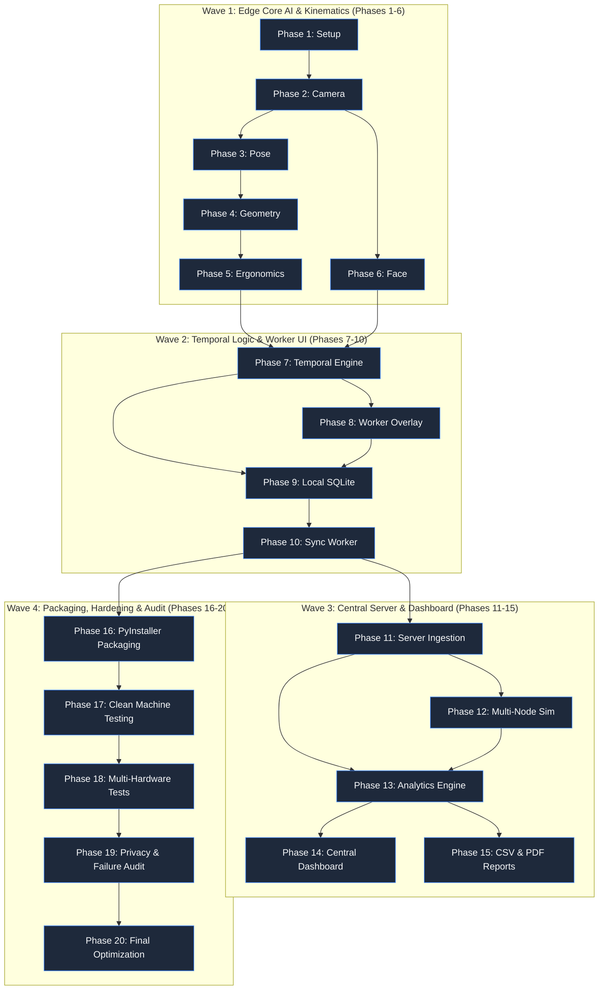

# Development Plan & Phase Roadmap

This document outlines the sequential 20-phase engineering plan for EdgeErgo, detailing the scope, technical deliverables, inter-phase dependencies, and current tracking status for every component across the Edge Agent, Central Server, and Administrative Dashboard (PRD §92–§111).

---

## 1. Master Development Phases Table

| Phase | Phase Name / Scope | Key Deliverable | Dependencies | Status |
| :---: | :--- | :--- | :---: | :---: |
| **Phase 1** | **Project Setup & Repository Architecture** | Standardized folder structure, virtual environments, base dependencies, CI linting rules (PRD §92). | None | Not started |
| **Phase 2** | **Camera Module & Device Management** | Resilient OpenCV video capture loop, hardware camera enumeration, resolution downscaling (320×240) (PRD §93). | Phase 1 | Not started |
| **Phase 3** | **Pose Detection Engine** | MediaPipe BlazePose pipeline extracting 33 normalized 3D skeletal landmarks in RAM (PRD §94). | Phase 2 | Not started |
| **Phase 4** | **Geometry Engine & Angle Kinematics** | NumPy 3D vector math computing neck, trunk, shoulder, elbow, and wrist angles via dot products (PRD §95). | Phase 3 | Not started |
| **Phase 5** | **Ergonomic Assessment Engine** | Pure Python RULA (Tables A/B/C) and REBA deterministic scoring tables decoupled from vision (PRD §96). | Phase 4 | Not started |
| **Phase 6** | **Facial Expression Analysis Engine** | MediaPipe Face Mesh module computing EAR, MAR, and brow furrow into 4 observable classes (PRD §97). | Phase 2 | Not started |
| **Phase 7** | **Temporal State Engine** | Sliding window persistence filter (20s) and alert cooldown throttling manager (120s) (PRD §98). | Phase 5, 6 | Not started |
| **Phase 8** | **Worker Desktop Feedback Overlay** | Native PySide6 hardware-accelerated translucent desktop status pill and auto-dismissing toasts (PRD §99). | Phase 7 | Not started |
| **Phase 9** | **Local Storage & Session Management** | Embedded SQLite schema (`sessions`, `telemetry_windows`, `posture_events`, `sync_queue`) in WAL mode (PRD §100). | Phase 7, 8 | Not started |
| **Phase 10**| **Edge-to-Server Synchronization Worker** | Asynchronous HTTP sync queue processor with exponential backoff and jitter (PRD §101). | Phase 9 | Not started |
| **Phase 11**| **Central Server Ingestion & Validation** | FastAPI REST API with Pydantic v2 schemas and SHA-256 window hash deduplication (PRD §102). | Phase 10 | Not started |
| **Phase 12**| **Multi-Node Networking & Simulation** | Multi-node test harness simulating 10 concurrent edge nodes with varied network drops (PRD §103). | Phase 11 | Not started |
| **Phase 13**| **Collective Analytics & Aggregation Engine** | Pandas aggregation pipelines computing daily workstation rollups and collective organizational trends (PRD §104). | Phase 11, 12 | Not started |
| **Phase 14**| **Central Administrative Dashboard** | React 18 + Vite + Tailwind dark enterprise analytics SPA with KPI cards and charts (PRD §105). | Phase 13 | Not started |
| **Phase 15**| **CSV Export & Executive Report Generation** | Automated CSV export engine and ReportLab PDF executive briefing synthesizer (PRD §106). | Phase 13, 14 | Not started |
| **Phase 16**| **Standalone PyInstaller Packaging** | Standalone Windows executable bundle (`EdgeErgoAgent.exe`) with bundled models (PRD §107). | Phase 8, 9, 10 | Not started |
| **Phase 17**| **Clean Environment Validation** | Automated validation script testing execution on clean Windows machines lacking Python (PRD §108). | Phase 16 | Not started |
| **Phase 18**| **Multi-Hardware Compatibility Testing** | Cross-hardware testing across Intel/AMD processors, external webcams, and display scales (PRD §109). | Phase 17 | Not started |
| **Phase 19**| **Failure Injection & Zero-Leakage Privacy Audit**| Live packet sniffing proving 0 bytes raw video egress during server drops and crashes (PRD §110). | Phase 12, 18 | Not started |
| **Phase 20**| **Final Benchmarking & Calibration** | Empirical benchmarking of duty cycles, latency profiling, and parameter fine-tuning (PRD §111). | Phase 19 | Not started |

---

## 2. Phase Execution Sequence & Critical Path

The project execution is organized into four major functional waves:

---

## 3. Phase Dependency Rules

To prevent architectural debt and integration bottlenecks, the following rules govern phase transitions:
1. **Decoupled Scoring (Phase 5 before Phase 7)**: The RULA and REBA scoring algorithms must be verified with 100% test coverage using synthetic angle fixtures before integration into temporal state engines.
2. **Local Persistence Precedes Sync (Phase 9 before Phase 10)**: The Edge Agent must prove reliable atomic commits to `edgeergo_local.db` before any HTTP network transmission code is introduced.
3. **Pydantic Validation Guardrail (Phase 11 before Phase 13)**: The Central Server must strictly enforce the telemetry contract schema before any aggregation pipelines or dashboard views consume ingested summaries.
4. **Zero-Leakage Privacy Audit as Gateway (Phase 19 before Phase 20)**: Final performance and deployment sign-off cannot occur until the live traffic audit ([`scripts/audit_privacy.py`](file:///c:/Users/georg/EDGE-ERGO%20V3/scripts/audit_privacy.py)) certifies zero media data transmission.

---

## Related Documents
- [01-project-overview.md](file:///c:/Users/georg/EDGE-ERGO%20V3/docs/architecture/01-project-overview.md) — Product goals and deliverables.
- [02-system-architecture.md](file:///c:/Users/georg/EDGE-ERGO%20V3/docs/architecture/02-system-architecture.md) — Two-layer architecture being implemented.
- [testing-strategy.md](file:///c:/Users/georg/EDGE-ERGO%20V3/docs/research/testing-strategy.md) — Acceptance criteria and test mapping for each phase.
- [OPEN_QUESTIONS.md](file:///c:/Users/georg/EDGE-ERGO%20V3/docs/OPEN_QUESTIONS.md) — Open items to resolve during implementation.
