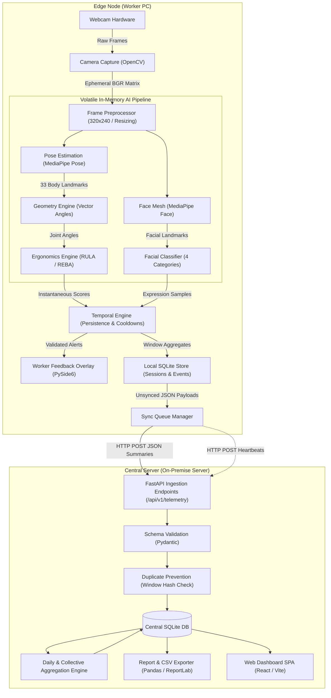
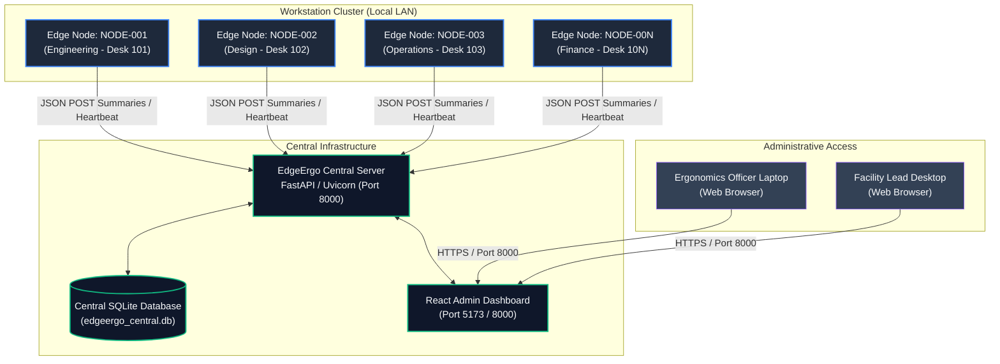

# 02. System Architecture

EdgeErgo employs a decoupled two-layer distributed architecture separating individual real-time edge processing from collective central aggregation. This design ensures absolute local privacy, zero raw video transmission, continuous offline operation, and scalable organizational visibility.

---

## 1. Two-Layer Architectural Model

EdgeErgo divides all computation, storage, and presentation across two distinct physical environments (PRD §9, §14, §118):
1. **The Edge Layer (Worker PC)**: An autonomous software agent running locally on each worker workstation. It interfaces directly with the workstation's webcam, extracts skeletal and facial landmarks, calculates ergonomic and expressive metrics, generates real-time desktop alerts, and manages a local offline-capable database.
2. **The Central Layer (Central Server)**: A centralized server application deployed on an organization's local area network (LAN) or secure intranet. It ingests anonymized window summaries from all registered Edge Nodes, prevents duplicate submissions, calculates collective statistics, generates compliance reports, and hosts an interactive web dashboard for administrators.

```
+===================================================================================+
|                                    EDGE LAYER                                     |
|                                                                                   |
|  +--------------------+     +--------------------+     +--------------------+     |
|  |     Edge Node      |     |     Edge Node      |     |     Edge Node      |     |
|  |     [NODE-001]     |     |     [NODE-002]     |     |     [NODE-N]       |     |
|  |  Worker PC (Win)   |     |  Worker PC (Win)   |     |  Worker PC (Win)   |     |
|  |                    |     |                    |     |                    |     |
|  | - Video in RAM     |     | - Video in RAM     |     | - Video in RAM     |     |
|  | - Local CV & AI    |     | - Local CV & AI    |     | - Local CV & AI    |     |
|  | - Local PySide6 UI |     | - Local PySide6 UI |     | - Local PySide6 UI |     |
|  | - Local SQLite DB  |     | - Local SQLite DB  |     | - Local SQLite DB  |     |
|  +---------+----------+     +---------+----------+     +---------+----------+     |
+============|==========================|==========================|================+
             |                          |                          |
             | Anonymized Window JSON   | Anonymized Window JSON   | Anonymized Window JSON
             | (REST / LAN HTTP)        | (REST / LAN HTTP)        | (REST / LAN HTTP)
             v                          v                          v
+===================================================================================+
|                                   CENTRAL LAYER                                   |
|                                                                                   |
|                              +----------------------+                             |
|                              |    Central Server    |                             |
|                              |   (FastAPI Backend)  |                             |
|                              +----------+-----------+                             |
|                                         |                                         |
|                 +-----------------------+-----------------------+                 |
|                 |                                               |                 |
|                 v                                               v                 |
|     +-----------------------+                       +-----------------------+     |
|     |   Central SQLite DB   |                       |  React Web Dashboard  |     |
|     |  (Summaries & Aggs)   |                       |    (Supervisor UI)    |     |
|     +-----------------------+                       +-----------------------+     |
+===================================================================================+
```

---

## 2. Layer Responsibilities

The strict operational division of responsibilities guarantees privacy, resilience, and minimal network overhead (PRD §10, §11):

| Layer | Environment | Key Responsibilities | Excluded Operations |
| :--- | :--- | :--- | :--- |
| **Edge Layer** | Worker Workstation (Standard Office PC / Laptop) | • Capture video frames at reduced resolution.<br>• Extract 33 pose landmarks & facial mesh points in RAM.<br>• Calculate joint vectors and biomechanical angles.<br>• Compute standard RULA and REBA risk scores.<br>• Classify observable facial expression categories.<br>• Evaluate temporal persistence (filtering out fidgeting).<br>• Trigger real-time worker alerts via desktop overlay.<br>• Maintain local SQLite history & retry sync queue.<br>• Transmit anonymized JSON window summaries. | • Storing raw video or cropped face images.<br>• Uploading video frames to network.<br>• Transmitting biometric embeddings.<br>• Executing facial identification.<br>• Making clinical psychological claims.<br>• Running React web interfaces. |
| **Central Layer** | On-Premise Central Server / Local Network Host | • Register and catalog active Edge Nodes.<br>• Monitor node connectivity via periodic heartbeats.<br>• Validate incoming JSON schema contracts.<br>• Enforce idempotent duplicate prevention.<br>• Store anonymized telemetry summaries in Central SQLite.<br>• Aggregate daily workstation and collective scores.<br>• Generate exportable CSV files and PDF reports.<br>• Serve the React-based administrative analytics SPA. | • Connecting to worker webcams.<br>• Accessing worker desktop displays.<br>• Reconstructing individual video streams.<br>• Tracking employee identities or names.<br>• Direct individual worker surveillance. |

---

## 3. Detailed Component Architecture

The diagram below illustrates the comprehensive internal architecture of both the Edge Agent and the Central Server, tracing data flow from optical photon capture down to executive analytics (PRD §10, §11, §118):



---

## 4. Multi-Node Deployment Topology

In an enterprise or laboratory deployment, multiple independent Edge Nodes communicate asynchronously with a single Central Server across a standard corporate LAN (PRD §64, §78, §119):



### Topology Characteristics:
- **Node Identifier Convention**: Each edge installation is provisioned with a persistent unique node identifier formatted as `NODE-XXX` (e.g., `NODE-001`, `NODE-042`). No worker names, email addresses, or Active Directory usernames are linked to this identifier (PRD §42, §63).
- **Loose Coupling**: Edge Nodes do not maintain open, stateful socket connections (e.g., persistent WebSocket or WebRTC streams). Communication is purely transactional HTTP REST requests dispatched at window intervals (e.g., every 5 minutes) or during node heartbeats (PRD §41, §64).
- **Partition Tolerance**: If the Central Server reboots, encounters maintenance downtime, or the network switch fails, every Edge Node continues monitoring, alerting, and persisting data locally without operational interruption (PRD §39, §65).

---

## 5. Architectural Invariants

The EdgeErgo architecture enforces five rigid boundaries:
1. **Volatile Vision Memory**: Frame buffers are allocated in heap memory, passed through MediaPipe pipelines, and immediately garbage collected. The Edge Agent possesses no disk-write routines for visual media (PRD §1, §6, §63).
2. **One-Way Ingestion**: Data flows unidirectionally from Edge Nodes to the Central Server. The Central Server cannot remotely command an Edge Node's camera to capture video, stream frames, or alter local desktop states (PRD §62).
3. **Discrete Duty Cycles**: Vision analysis runs in periodic duty cycles (e.g., 30-second sampling bursts per 5-minute interval) rather than continuous 24/7 video capture, dramatically minimizing thermal and CPU impact (PRD §15, §17.3).
4. **Isolated Presentation Frameworks**: The React frontend framework is strictly isolated to the Central Server web dashboard. Worker machines execute a featherweight PySide6 Qt GUI layer consuming negligible system RAM (PRD §12, §14).
5. **Idempotent Ingestion**: Every telemetry window is generated with a cryptographic content hash (`window_hash`). Resubmissions resulting from network retries are deduplicated effortlessly at the database layer (PRD §87).

---

## Related Documents
- [01-project-overview.md](file:///c:/Users/georg/EDGE-ERGO%20V3/docs/architecture/01-project-overview.md) — Mission and core design principles.
- [03-tech-stack.md](file:///c:/Users/georg/EDGE-ERGO%20V3/docs/architecture/03-tech-stack.md) — Technology selections for Edge and Central.
- [04-edge-agent-workflow.md](file:///c:/Users/georg/EDGE-ERGO%20V3/docs/architecture/04-edge-agent-workflow.md) — Edge pipeline details.
- [05-central-server-workflow.md](file:///c:/Users/georg/EDGE-ERGO%20V3/docs/architecture/05-central-server-workflow.md) — Central ingestion details.
- [06-data-flow-and-privacy.md](file:///c:/Users/georg/EDGE-ERGO%20V3/docs/architecture/06-data-flow-and-privacy.md) — Data flow and privacy boundaries.
