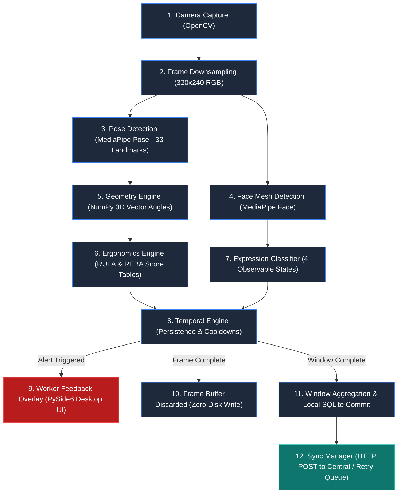
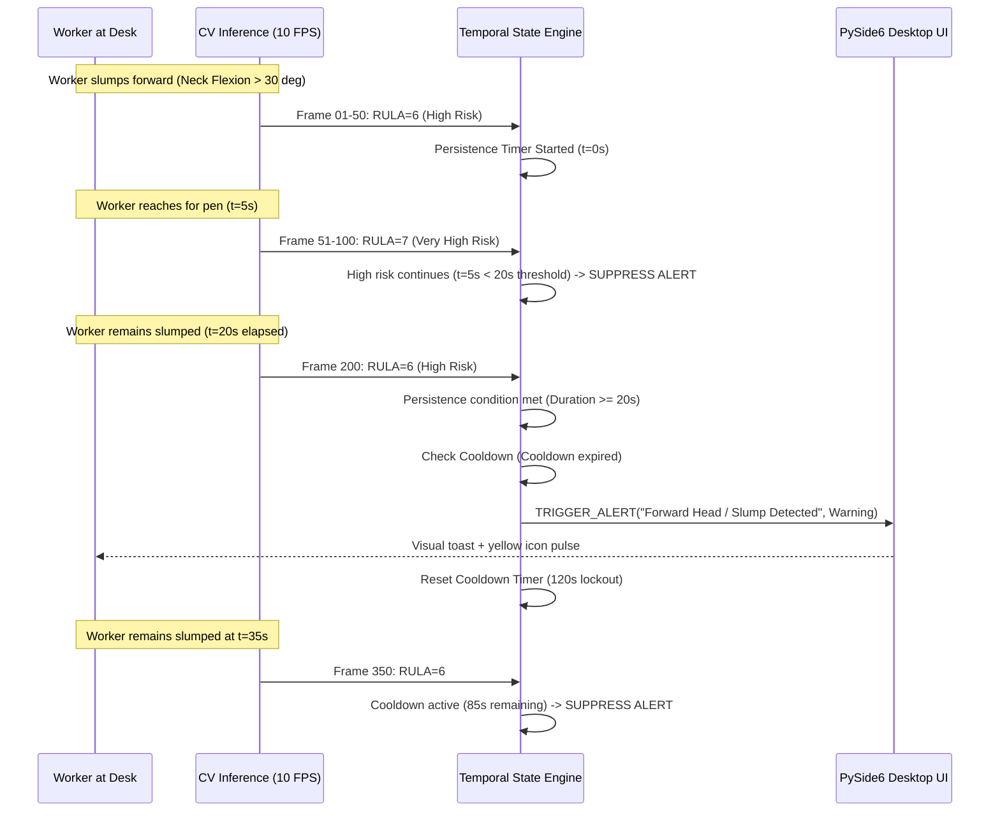

# 04. Edge Agent Workflow

The Edge Agent is an autonomous, lightweight Python background service executing on each worker's computer. It performs real-time monocular computer vision, joint angle kinematics, deterministic ergonomic scoring, non-biometric facial affect observation, temporal persistence filtering, native desktop notifications, and local offline-capable database synchronization.

---

## 1. Step-by-Step Edge Processing Pipeline

The Edge Agent operates in an event-driven duty cycle, executing a 12-stage sequential pipeline entirely within the worker computer's volatile memory (PRD §10, §15, §118; TECH §1):



### Detailed Pipeline Stages

#### Stage 1: Camera Access & Acquisition (PRD §18)
- Interfaces with the designated video capture device using OpenCV (`cv2.VideoCapture`).
- Handles device enumeration, camera index selection (e.g., integrated webcam vs. external USB camera), and graceful reconnection upon USB disconnect.

#### Stage 2: Frame Downsampling & Preprocessing (PRD §17.1, §18)
- Downsamples incoming raw frames (typically 1280×720 or 1920×1080) down to **320×240** or **640×480** pixels.
- Converts OpenCV's native BGR color representation to RGB required by MediaPipe.
- Downsampling slashes CPU inference latency by ~65% while preserving sufficient landmark spatial resolution for skeletal joint detection.

#### Stage 3: Pose Landmark Detection (PRD §19)
- Passes the preprocessed RGB frame into Google MediaPipe Pose (BlazePose model).
- Extracts normalized 3D spatial coordinates $(x, y, z)$ and visibility confidence scores for 33 standard human landmarks, specifically:
  - Nose, ears, and neck reference points (Landmarks 0, 7, 8).
  - Left and right shoulders (Landmarks 11, 12).
  - Left and right elbows (Landmarks 13, 14).
  - Left and right wrists (Landmarks 15, 16).
  - Left and right hips (Landmarks 23, 24).

#### Stage 4: Facial Mesh & Landmark Detection (PRD §27)
- Concurrently processes the head region using MediaPipe Face Mesh.
- Extracts key facial fiducial points around the eyes, eyelids, eyebrows, and lips without storing or extracting deep face embeddings.

#### Stage 5: Geometry Engine & Angle Computation (PRD §21)
- Formulates anatomical directional vectors between connected skeletal landmarks using NumPy:
  $$\mathbf{v}_{\text{upper\_arm}} = \mathbf{p}_{\text{elbow}} - \mathbf{p}_{\text{shoulder}}$$
  $$\mathbf{v}_{\text{trunk}} = \mathbf{p}_{\text{hip}} - \mathbf{p}_{\text{shoulder}}$$
- Calculates planar and spatial flexion/extension angles using vector dot products:
  $$\theta = \arccos\left(\frac{\mathbf{u} \cdot \mathbf{v}}{\|\mathbf{u}\| \|\mathbf{v}\|}\right) \times \frac{180^\circ}{\pi}$$
- Computes specific angles: Neck Flexion, Trunk Inclination, Shoulder Elevation, Upper Arm Elevation, Lower Arm Angle, and Wrist Angle.

#### Stage 6: Ergonomic Assessment Engine (PRD §22, §23, §24, §25)
- Feeds computed joint angles into independent lookup algorithms conforming to published ergonomics standards:
  - **RULA Engine**: Evaluates upper-body posture, generating Table A (Arm/Wrist), Table B (Neck/Trunk/Leg), and final Grand Scores (1–7).
  - **REBA Engine**: Evaluates whole-body biomechanical loads, generating Group A, Group B, and final Grand Scores (1–15).
- Categorizes postures into risk tiers: *Low Risk (1–2)*, *Medium Risk (3–4)*, *High Risk (5–6)*, and *Very High Risk (7+)*.

#### Stage 7: Facial Expression Classification (PRD §27)
- Analyzes facial geometric ratios:
  - **Eye Aspect Ratio (EAR)**: Computes palpebral fissure height vs. width to detect sustained squinting or prolonged eye closure (fatigue indicators).
  - **Mouth Aspect Ratio (MAR)**: Tracks lip aperture to identify talking or yawning.
  - **Brow Furrow Metric**: Measures inner eyebrow distance to detect brow tension.
- Categorizes the frame into one of four broad observational classes:
  1. *Neutral*
  2. *Expressive / Engaged*
  3. *Fatigued / Strained Indicators*
  4. *Mouth Movement / Talking*

#### Stage 8: Temporal Engine & Persistence Filtering (PRD §17.4, §26, §35, §36)
- Ingests instantaneous frame scores and updates a sliding temporal state window.
- **Persistence Verification**: Evaluates whether a high-risk posture is sustained continuously for $\ge \Delta t_{\text{persistence}}$ (default: 15–30 seconds) to filter out normal fidgeting or temporary object reaches.
- **Cooldown Throttling**: Suppresses repetitive alerts of the same type within $\Delta t_{\text{cooldown}}$ (default: 60–120 seconds).
- **Alert Priority Enforcement**: Evaluates active conditions against a strict hierarchy before notifying the worker.

#### Stage 9: Worker Feedback Overlay (PRD §30–§34)
- When a sustained adverse condition satisfies persistence and cooldown rules, the Temporal Engine signals the PySide6 desktop overlay.
- Displays non-intrusive visual cues: status badge color shifts (Green $\to$ Yellow $\to$ Red), posture coaching popups, or break/hydration dialogs.

#### Stage 10: Instantaneous Frame Buffer Disposal (PRD §1, §6, §63)
- The raw image array, downscaled frames, and landmark coordinate arrays are dereferenced immediately. Python's memory manager reclaims the heap buffer.
- **Zero raw video or image pixels are ever written to the hard drive.**

#### Stage 11: Window Aggregation & Local SQLite Storage (PRD §37, §38, §49)
- At the conclusion of a monitoring window (e.g., 5 minutes of total elapsed session time):
  - Calculates average and maximum RULA/REBA scores.
  - Computes time percentages spent in each risk tier and expression category.
  - Compiles posture violation counts and break compliance events.
- Writes the completed summary record to the local SQLite database (`edgeergo_local.db`).
- Inserts an unsent record into the local `sync_queue` table.

#### Stage 12: Sync Manager & Central Ingestion (PRD §40, §41)
- The asynchronous sync worker dequeues pending payloads from `sync_queue`.
- Dispatches an HTTP `POST /api/v1/telemetry` request to the Central Server.
- On HTTP `200 OK`, updates the local queue record to status `SENT`.
- If the server is unreachable, leaves the record marked `PENDING` and schedules a retry with exponential backoff.

---

## 2. Monitoring Schedule & Duty Cycle

EdgeErgo does not perform continuous 24/7 video capture. Running computer vision continuously at 30 FPS would impose unacceptable CPU load and battery drain on office laptops. Instead, the Edge Agent utilizes configurable duty cycling and frame skipping (PRD §15, §16, §17.2, §17.3):

```
Time Horizon: [ 5-Minute Window ] ------------------------------------------------------------>
Active Window: |=== Sampling Duration (30s) ===|------------- Idle Duration (4.5 min) ---------|
Frame Stream:  | X . . X . . X . . X . . X . . | (Camera Closed / Zero CV Processing)         |
               (Process 1 of every 3 frames = 10 FPS)
```

### Scheduling Parameters:
- **Monitoring Interval (`monitoring_interval_minutes`)**: The total repetition period of a monitoring cycle (default: **5 minutes**, range: 2–15 minutes).
- **Sampling Duration (`analysis_duration_seconds`)**: The active camera sampling duration per cycle (default: **30 seconds**, range: 15–60 seconds).
- **Continuous Mode Option**: A user-toggleable debug/calibration mode allowing uninterrupted real-time tracking during initial chair/camera setup.
- **Frame Skipping (`frame_skip_step`)**: When the camera is active at 30 FPS, the agent processes every $n$-th frame (default: step = 3 $\implies$ 10 FPS effective). Biomechanical posture transitions occur over seconds; 10 FPS provides more than sufficient temporal fidelity while cutting compute requirements by 66%.

---

## 3. Temporal Persistence & Alert Rules

A critical flaw of naive computer vision posture checkers is false alarm fatigue caused by reacting to momentary motions (e.g., reaching for a mug, turning to speak to a colleague). EdgeErgo solves this through temporal persistence and alert throttling (PRD §26, §35, §36):



### 3.1 Persistence Thresholds (PRD §26)
- **Posture Warning Persistence**: Default: **20 seconds** (range: 10–60 seconds). An ergonomic alert is generated *only* if high or very high risk scores persist uninterrupted across consecutive frames for this duration.
- **Posture Reset Threshold**: If the worker returns to an acceptable neutral posture (RULA $\le 3$) for $\ge 5$ continuous seconds, the persistence accumulator resets to zero.

### 3.2 Alert Cooldown Throttling (PRD §36)
- To prevent distracting workers, identical posture alerts enforce a minimum cooldown interval (default: **120 seconds**, range: 60–300 seconds).

### 3.3 Strict Alert Priority Order (PRD §35)
When multiple advisory conditions coincide, the Temporal Engine evaluates alerts against a rigid priority ladder, presenting only the highest-priority notification:

```
[Priority 1: HIGHEST]  Movement Break Reminder (Sustained sitting >= 50-60 min)
         |
[Priority 2]           Hydration Reminder (Configured interval >= 60-90 min)
         |
[Priority 3]           Critical Posture Alert (Very High Risk RULA >= 7 for > 30s)
         |
[Priority 4]           Moderate Posture Warning (High Risk RULA 5-6 for > 20s)
         |
[Priority 5: LOWEST]   Fatigue / Facial Tension Indicator (Observed sustained squint/strain)
```

---

## 4. First-Time Setup & Background Operation

### 4.1 First-Time Setup Flow (PRD §43, §44)
When EdgeErgo is launched for the first time on a new workstation:
1. **Node Provisioning**: If `config.json` lacks a `node_id`, the agent auto-generates a unique identifier (or prompts for assigned name `NODE-XXX`).
2. **Server Pairing**: Prompts the user or installer script for the Central Server IP address and port (e.g., `http://192.168.1.100:8000`).
3. **Camera Selection**: Enumerates available video capture devices, presenting a drop-down selector and real-time preview skeleton.
4. **Registration Dispatch**: Dispatches `POST /api/v1/nodes/register` containing hardware metadata, agent version, and assigned node ID.
5. **Local DB Initialization**: Executes SQLite schema creation scripts, creating `sessions`, `telemetry_windows`, `posture_events`, and `sync_queue`.

### 4.2 Background Operation & Tray Behavior (PRD §45)
- **System Tray Integration**: EdgeErgo minimizes to the Windows System Notification Area (System Tray).
- **Context Menu Options**:
  - *Open Dashboard Overlay* (Toggles the PySide6 on-screen widget).
  - *Pause Monitoring* (Temporarily disables camera capture for 15, 30, or 60 minutes).
  - *Trigger Manual Break* (Records an immediate stretching/walk event).
  - *Settings / Camera Setup* (Opens configuration dialog).
  - *Exit EdgeErgo* (Gracefully terminates capture, flushes database, and exits).
- **Low Overhead**: While running in the background between duty cycles, the agent releases camera handles and sleeps, consuming `<0.5%` CPU.

---

## 5. Failure & Edge Case Handling

The Edge Agent gracefully handles common workplace real-world scenarios (PRD §66–§69):

| Scenario | Detection Mechanism | Edge Agent Response |
| :--- | :--- | :--- |
| **Camera Disconnected / In Use** | OpenCV `cap.read()` returns `False` or fails to open device index. | Logs warning; pauses sampling; displays "Camera Unavailable" icon in tray; retries access every 30 seconds without crashing. |
| **Person Absent (Desk Empty)** | MediaPipe Pose returns zero detected landmarks or pose visibility $<0.5$. | Marks state as `OPERATOR_AWAY`; suspends posture scoring; increments away-time counter; suppresses break reminders while desk is empty. |
| **Low Confidence / Occlusion** | Key upper-body landmarks (shoulders, neck) exhibit confidence scores $<0.6$ due to dark lighting or loose clothing. | Discards instantaneous frame scores; excludes frame from RULA averages; does not trigger alerts on ambiguous geometry. |
| **Multiple People in View** | MediaPipe detects multiple human bounding boxes (e.g., colleagues walking behind desk). | Identifies and locks onto the largest, most central foreground bounding box; strictly discards peripheral background landmarks. |

---

## Related Documents
- [02-system-architecture.md](file:///c:/Users/georg/EDGE-ERGO%20V3/docs/architecture/02-system-architecture.md) — Architectural overview.
- [06-data-flow-and-privacy.md](file:///c:/Users/georg/EDGE-ERGO%20V3/docs/architecture/06-data-flow-and-privacy.md) — Privacy boundaries and data protection.
- [08-offline-and-sync.md](file:///c:/Users/georg/EDGE-ERGO%20V3/docs/architecture/08-offline-and-sync.md) — Sync queue lifecycle and retry logic.
- [09-ergonomics-methodology.md](file:///c:/Users/georg/EDGE-ERGO%20V3/docs/architecture/09-ergonomics-methodology.md) — RULA and REBA scoring mechanics.
