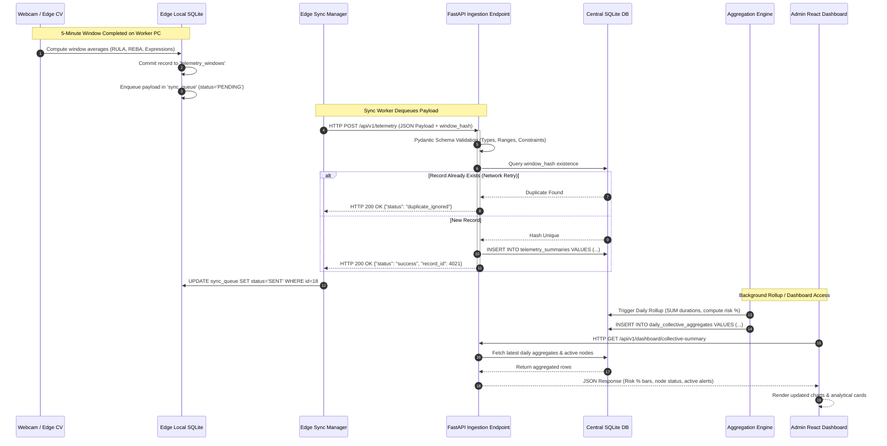

# 05. Central Server Workflow

The Central Server is an asynchronous, high-concurrency backend service powered by FastAPI and Uvicorn. It acts as the organizational clearinghouse for EdgeErgo, managing edge node registration, heartbeat health tracking, telemetry validation, idempotent storage, multi-workstation statistical aggregation, CSV exports, executive report generation, and real-time dashboard data serving.

---

## 1. End-to-End Central Processing Pipeline

The Central Server executes a continuous ingestion and analysis cycle, processing transactions from dozens or hundreds of distributed Edge Nodes (PRD §11, §41, §50; TECH §2):

```mermaid
flowchart TD
    subgraph IngestionBoundary["API Ingestion Boundary (FastAPI)"]
        A["Incoming HTTP POST Request"] --> B{"Route Resolution"}
        B -->|POST /nodes/register| C["Node Registration Service"]
        B -->|POST /nodes/heartbeat| D["Heartbeat & Liveness Tracker"]
        B -->|POST /telemetry| E["Telemetry Validation (Pydantic v2)"]
    end

    subgraph DataHygiene["Data Hygiene & Idempotency"]
        E -->|Valid JSON Contract| F{"Idempotency Check<br/>(Window Hash Lookup)"}
        E -->|Schema Error (422)| G["Reject & Log Error Response"]
        F -->|Hash Exists| H["Deduplicate: Return 200 OK (No Write)"]
        F -->|New Window| I["Commit to Central SQLite DB (telemetry_summaries)"]
    end

    subgraph ProcessingEngines["Analytics & Aggregation Engines"]
        I --> J["Workstation Aggregation Engine (Daily Node Rollup)"]
        I --> K["Collective Analytics Engine (Organization Trends)"]
        J --> L[(Central Database: SQLite)]
        K --> L
    end

    subgraph PresentationBoundary["Presentation & Export Layer"]
        L --> M["Admin Web Dashboard API (/api/v1/dashboard/*)"]
        L --> N["CSV Export Engine (/api/v1/export/csv)"]
        L --> O["Executive Report Generator (ReportLab PDF / HTML)"]
    end

    classDef api fill:#1e293b,stroke:#3b82f6,stroke-width:1px,color:#f8fafc;
    classDef check fill:#854d0e,stroke:#eab308,stroke-width:1px,color:#ffffff;
    classDef success fill:#065f46,stroke:#10b981,stroke-width:1px,color:#ffffff;
    classDef error fill:#991b1b,stroke:#ef4444,stroke-width:1px,color:#ffffff;
    
    class A,B,C,D,E,J,K,M,N,O api;
    class F check;
    class I,L success;
    class G,H error;
```

---

## 2. Core Server Services

### 2.1 Node Registration Service (`/api/v1/nodes/register`) (PRD §42)
When an Edge Node is launched for the first time or re-provisioned:
- Validates the unique hardware identity and client configuration.
- Checks if the requested `node_id` (e.g., `NODE-001`) already exists in the `nodes` table:
  - If existing: Updates hardware details, IP address, OS version, agent software version, and sets status to `ACTIVE`.
  - If new: Provisions a new record, assigns registration timestamp, records department metadata, and returns an enrollment acknowledgment.

### 2.2 Heartbeat & Liveness Tracker (`/api/v1/nodes/heartbeat`) (PRD §46)
- Edge Nodes dispatch lightweight heartbeat pings at periodic intervals (default: every 60 seconds).
- The heartbeat payload conveys real-time runtime state:
  - `node_id`, `agent_version`, `monitoring_state` (`ACTIVE`, `PAUSED`, `AWAY`, `CAMERA_OFFLINE`), and `local_queue_depth`.
- The server updates the node's `last_heartbeat` timestamp in memory and SQLite.
- **Node Status Thresholds**:
  - `ONLINE`: Heartbeat received within the last 120 seconds.
  - `STALE`: No heartbeat received for >120 seconds.
  - `OFFLINE`: No heartbeat received for >300 seconds (5 minutes).

### 2.3 Telemetry Validation & Ingestion (`/api/v1/telemetry`) (PRD §48, §49, §88, §89)
The primary ingestion gateway for window summaries:
- **Contract Enforcement**: Pydantic models validate every field:
  - `rula_grand_score_avg` must fall between $1.0$ and $7.0$.
  - `reba_grand_score_avg` must fall between $1.0$ and $15.0$.
  - Percentage allocations (`pct_low_risk`, `pct_medium_risk`, `pct_high_risk`, `pct_very_high_risk`) must sum to $\le 100\%$.
  - `window_duration_seconds` must be $>0$.
- Rejects malformed requests with standard HTTP `422 Unprocessable Entity` containing exact JSON path errors.

### 2.4 Idempotent Deduplication Engine (PRD §87)
Network glitches often cause clients to retry requests that the server actually received. EdgeErgo prevents duplicate records through cryptographic hashing:
- Each telemetry window is assigned a SHA-256 hash computed over canonical keys:
  $$\text{window\_hash} = \text{SHA256}(\text{node\_id} + \text{window\_start} + \text{window\_end} + \text{sample\_count})$$
- The database enforces a `UNIQUE` index on `(node_id, window_hash)`.
- If an incoming payload contains an existing hash, the server immediately returns `200 OK` (with `"status": "duplicate_ignored"`), preventing duplicate row insertion while signaling the client to safely purge the item from its local queue.

### 2.5 Multi-Level Aggregation Engine (PRD §50, §51, §55)
Calculates higher-order metrics on a scheduled cycle (or on-demand during dashboard requests):
- **Workstation Level**: Aggregates a specific node's windows across a single working day (total monitored hours, peak risk periods, break adherence percentage).
- **Collective Level**: Aggregates all active nodes across departments (overall organizational risk distribution, high-risk hour heatmaps, collective facial engagement patterns).

### 2.6 Reporting & Export Services (PRD §57, §58)
- **CSV Exporter**: Generates flattened, standardized CSV files of raw telemetry summaries and daily rollups for export into statistical packages (R, SPSS, Excel).
- **Executive Report Generator**: Synthesizes periodic (daily, weekly, monthly) PDF/HTML executive briefings containing charts, risk distributions, break compliance statistics, and actionable workplace recommendations.

---

## 3. Telemetry Window Lifecycle Sequence

The following sequence diagram traces the path of a 5-minute telemetry summary as it moves from the Edge Agent's local camera to the Central Server database and onto an administrator's browser (PRD §118):



---

## 4. Duplicate Prevention & Transaction Guarantees

Because Edge Nodes operate in unpredictable enterprise network conditions, duplicate submissions are an anticipated normal occurrence rather than an error (PRD §87):

```
+-----------------------------------------------------------------------------+
|                     IDEMPOTENT DEDUPLICATION GUARANTEE                      |
|                                                                             |
|  Edge Node (NODE-001)                     Central Server (FastAPI)          |
|  +--------------------+                   +--------------------+            |
|  | Dispatches Window  | -- POST Window -> | Validates Schema   |            |
|  | Hash: 9f8a...3b    |                   | Writes to Database |            |
|  +--------------------+                   +----------+---------+            |
|           |                                          |                      |
|           x <------ Network Drop / Ack Lost ---------+                      |
|           |                                                                 |
|  +--------------------+                   +--------------------+            |
|  | Retries Dispatch   | -- POST Window -> | Inspects Hash Index|            |
|  | Hash: 9f8a...3b    |                   | Matched existing!  |            |
|  +--------------------+                   | Suppresses Write   |            |
|           ^                               +----------+---------+            |
|           |                                          |                      |
|           +-------- HTTP 200 OK (Duplicate) <--------+                      |
|                     Marks Queue Item SENT                                   |
+-----------------------------------------------------------------------------+
```

### Key Guarantees:
1. **Zero Double-Counting**: Re-transmissions caused by dropped HTTP ACKs never distort daily ergonomic risk percentages or exposure hours.
2. **Atomic Ingestion**: Each valid telemetry payload is written in a single SQLite ACID transaction.
3. **Queue Clearance**: Receiving an HTTP 200 response (whether for a new write or an acknowledged duplicate) immediately releases the item from the client's local retry queue.

---

## 5. Server Failure & Recovery Behavior

The Central Server architecture is entirely stateless with respect to worker sessions (PRD §65):
- **Server Shutdown**: If the server process stops for maintenance or system updates, incoming HTTP requests fail gracefully with connection errors. Edge Agents quietly retain data in their local `sync_queue`.
- **Server Restart**: Upon reboot, FastAPI re-initializes SQLite database connection pools, verifies table schemas, and resumes accepting ingestions.
- **Catch-Up Ingestion**: Reconnected Edge Nodes flush their accumulated queues sequentially. The server's high-throughput ASGI pipeline easily absorbs backlogged batches without packet loss.

---

## Related Documents
- [02-system-architecture.md](file:///c:/Users/georg/EDGE-ERGO%20V3/docs/architecture/02-system-architecture.md) — Multi-node topology.
- [04-edge-agent-workflow.md](file:///c:/Users/georg/EDGE-ERGO%20V3/docs/architecture/04-edge-agent-workflow.md) — Edge telemetry generation.
- [07-data-models.md](file:///c:/Users/georg/EDGE-ERGO%20V3/docs/architecture/07-data-models.md) — Central SQLite table definitions.
- [08-offline-and-sync.md](file:///c:/Users/georg/EDGE-ERGO%20V3/docs/architecture/08-offline-and-sync.md) — Queue retry protocols.
- [api-reference.md](file:///c:/Users/georg/EDGE-ERGO%20V3/docs/api/api-reference.md) — Complete REST endpoint documentation.
