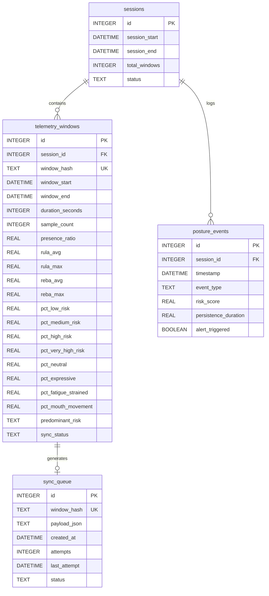

# 07. Data Models

EdgeErgo utilizes two decoupled relational databases implemented with SQLite: the local **Edge SQLite Database** (`edgeergo_local.db`) on each worker computer, and the **Central SQLite Database** (`edgeergo_central.db`) on the on-premise server. Both schemas strictly adhere to the summary-only constraint, containing zero binary media or biometric vectors.

---

## 1. Summary-Only Architectural Constraint

> [!IMPORTANT]
> **Summary-Only Storage Mandate:** Neither the Edge SQLite database nor the Central SQLite database contains binary large object (`BLOB`) columns, image paths, landmark coordinate vectors, or personal worker identities. All tables store only structured numerical measurements, aggregated proportions, and temporal timestamps (PRD §37, §48, §63).

---

## 2. Local Edge SQLite Schema (`edgeergo_local.db`)

The local database persists the worker's operational history, tracks desktop alerts, and manages the resilient synchronization queue (PRD §38):



### Table Definitions: Edge Database

#### `sessions`
Represents an uninterrupted period of agent execution on the worker's computer.
- `id` (INTEGER, PK, Auto-increment): Unique local session ID.
- `session_start` (DATETIME): Timestamp when monitoring commenced.
- `session_end` (DATETIME, Nullable): Timestamp when monitoring was gracefully halted.
- `total_windows` (INTEGER, Default: 0): Total count of 5-minute sampling windows evaluated.
- `status` (TEXT): Session lifecycle state (`ACTIVE`, `PAUSED`, `COMPLETED`).

#### `telemetry_windows`
Stores granular 5-minute aggregated posture and expression summaries.
- `id` (INTEGER, PK, Auto-increment): Local window record ID.
- `session_id` (INTEGER, FK $\to$ `sessions.id`): Associated session.
- `window_hash` (TEXT, UNIQUE): SHA-256 fingerprint of the window.
- `window_start` / `window_end` (DATETIME): Temporal boundaries of the window.
- `duration_seconds` (INTEGER): Total elapsed window seconds (typically 300).
- `sample_count` (INTEGER): Number of processed video frames within the duty cycle.
- `presence_ratio` (REAL): Fraction of samples where a worker was present ($0.0$ to $1.0$).
- `rula_avg` / `rula_max` (REAL): Mean and maximum RULA Grand Scores ($1.0$ to $7.0$).
- `reba_avg` / `reba_max` (REAL): Mean and maximum REBA Grand Scores ($1.0$ to $15.0$).
- `pct_low_risk` to `pct_very_high_risk` (REAL): Temporal percentage breakdown in each ergonomic tier.
- `pct_neutral` to `pct_mouth_movement` (REAL): Temporal percentage breakdown of observed expressions.
- `predominant_risk` (TEXT): Primary postural deficiency detected (e.g., `forward_head_flexion`).
- `sync_status` (TEXT): Synchronization state (`PENDING`, `SYNCED`).

#### `posture_events`
Audit log of significant ergonomic transitions and desktop alerts.
- `id` (INTEGER, PK, Auto-increment): Unique event ID.
- `session_id` (INTEGER, FK $\to$ `sessions.id`): Associated session.
- `timestamp` (DATETIME): Exact moment of event occurrence.
- `event_type` (TEXT): Category (`POSTURE_WARNING`, `BREAK_REMINDER`, `HYDRATION_REMINDER`, `POSTURE_RECOVERY`).
- `risk_score` (REAL): Instantaneous RULA score that triggered the event.
- `persistence_duration` (REAL): Number of seconds the condition persisted prior to trigger.
- `alert_triggered` (BOOLEAN): True if an overlay notification was displayed to the worker.

#### `sync_queue`
Manages asynchronous retry delivery to the Central Server.
- `id` (INTEGER, PK, Auto-increment): Queue transaction ID.
- `window_hash` (TEXT, UNIQUE): Fingerprint matching `telemetry_windows.window_hash`.
- `payload_json` (TEXT): Exact JSON string to transmit to `/api/v1/telemetry`.
- `created_at` (DATETIME): Queue entry insertion timestamp.
- `attempts` (INTEGER, Default: 0): Number of HTTP dispatch attempts made.
- `last_attempt` (DATETIME, Nullable): Timestamp of the most recent dispatch attempt.
- `status` (TEXT): Queue processing status (`PENDING`, `SENDING`, `SENT`, `FAILED`).

---

## 2. Central SQLite Schema (`edgeergo_central.db`)

The Central Server database stores multi-workstation records, historical summaries, and precomputed rollups for dashboard visualization (PRD §48):

```mermaid
erDiagram
    nodes ||--o{ telemetry_summaries : submits
    nodes ||--o{ daily_node_aggregates : summarizes
    daily_collective_aggregates ||--o{ reports : synthesizes

    nodes {
        INTEGER id PK
        TEXT node_id UK
        TEXT hostname
        TEXT ip_address
        TEXT os_version
        TEXT agent_version
        DATETIME registered_at
        DATETIME last_heartbeat
        TEXT status
        TEXT department
    }

    telemetry_summaries {
        INTEGER id PK
        TEXT node_id FK
        TEXT window_hash UK
        DATETIME window_start
        DATETIME window_end
        INTEGER duration_seconds
        INTEGER sample_count
        REAL presence_ratio
        REAL rula_avg
        REAL rula_max
        REAL reba_avg
        REAL reba_max
        REAL pct_low_risk
        REAL pct_medium_risk
        REAL pct_high_risk
        REAL pct_very_high_risk
        REAL pct_neutral
        REAL pct_expressive
        REAL pct_fatigue_strained
        REAL pct_mouth_movement
        TEXT predominant_risk
        DATETIME received_at
    }

    daily_node_aggregates {
        INTEGER id PK
        TEXT node_id FK
        DATE date
        INTEGER total_monitored_minutes
        INTEGER active_presence_minutes
        REAL rula_avg
        REAL reba_avg
        REAL pct_high_risk_exposure
        REAL break_compliance_pct
    }

    daily_collective_aggregates {
        INTEGER id PK
        DATE date
        INTEGER active_nodes_count
        REAL collective_rula_avg
        REAL collective_reba_avg
        REAL pct_collective_high_risk
        REAL collective_fatigue_pct
    }

    reports {
        INTEGER id PK
        TEXT report_type
        DATE date_range_start
        DATE date_range_end
        DATETIME generated_at
        TEXT file_path
    }
```



### Table Definitions: Central Database

#### `nodes`
Master catalog of registered worker workstations.
- `id` (INTEGER, PK, Auto-increment): Internal surrogate key.
- `node_id` (TEXT, UNIQUE): Logical station identifier (`NODE-001`, `NODE-002`).
- `hostname` / `ip_address` (TEXT): Workstation network addressing.
- `os_version` / `agent_version` (TEXT): Operating system and Edge Agent release string.
- `registered_at` (DATETIME): Initial enrollment timestamp.
- `last_heartbeat` (DATETIME): Timestamp of most recent liveness ping.
- `status` (TEXT): Operational health (`ONLINE`, `STALE`, `OFFLINE`).
- `department` (TEXT, Default: 'General'): Departmental grouping (e.g., 'Engineering', 'Customer Support').

#### `telemetry_summaries`
Ingested, validated window records from all nodes.
- `id` (INTEGER, PK, Auto-increment): Ingestion record ID.
- `node_id` (TEXT, FK $\to$ `nodes.node_id`): Submitting workstation.
- `window_hash` (TEXT, UNIQUE): Global deduplication hash.
- Metric columns mirror `telemetry_windows` (RULA, REBA, expression percentages, risk distribution).
- `received_at` (DATETIME): Server ingestion timestamp.

#### `daily_node_aggregates`
Precomputed daily rollups per individual workstation.
- `id` (INTEGER, PK, Auto-increment): Rollup ID.
- `node_id` (TEXT, FK $\to$ `nodes.node_id`): Workstation.
- `date` (DATE): Summary calendar date.
- `total_monitored_minutes` (INTEGER): Total duration agent was running.
- `active_presence_minutes` (INTEGER): Duration worker was actively seated.
- `rula_avg` / `reba_avg` (REAL): Day-long mean risk scores.
- `pct_high_risk_exposure` (REAL): Percentage of seated time spent in High/Very High risk.
- `break_compliance_pct` (REAL): Ratio of break recommendations followed.

#### `daily_collective_aggregates`
Macro-level organizational metrics across the entire enterprise.
- `id` (INTEGER, PK, Auto-increment): Collective record ID.
- `date` (DATE, UNIQUE): Summary calendar date.
- `active_nodes_count` (INTEGER): Total number of unique nodes active on that date.
- `collective_rula_avg` / `collective_reba_avg` (REAL): Organization-wide average scores.
- `pct_collective_high_risk` (REAL): Percentage of total organization hours at high risk.
- `collective_fatigue_pct` (REAL): Macro proportion of observed facial strain indicators.

#### `reports`
Catalog of generated export artifacts.
- `id` (INTEGER, PK, Auto-increment): Report artifact ID.
- `report_type` (TEXT): Format and scope (`DAILY_EXECUTIVE_PDF`, `WEEKLY_CSV_DUMP`).
- `date_range_start` / `date_range_end` (DATE): Covered date range.
- `generated_at` (DATETIME): Timestamp of synthesis.
- `file_path` (TEXT): Relative path on server disk (`exports/reports/daily_2026_10_14.pdf`).

---

## 3. Database Reliability & Indexing Strategy

To support high-throughput concurrent writes and sub-50ms dashboard response times, both databases incorporate strategic indexing and write-ahead logging (PRD §86):

```sql
-- Edge SQLite WAL Mode & Indexes
PRAGMA journal_mode = WAL;
PRAGMA synchronous = NORMAL;

CREATE INDEX idx_telemetry_windows_sync ON telemetry_windows(sync_status);
CREATE INDEX idx_sync_queue_status ON sync_queue(status);

-- Central SQLite Indexes
PRAGMA journal_mode = WAL;
PRAGMA synchronous = NORMAL;

CREATE UNIQUE INDEX idx_telemetry_summaries_hash ON telemetry_summaries(window_hash);
CREATE INDEX idx_telemetry_summaries_node_time ON telemetry_summaries(node_id, window_start);
CREATE INDEX idx_daily_node_date ON daily_node_aggregates(node_id, date);
CREATE INDEX idx_nodes_status ON nodes(status);
```

---

## Related Documents
- [04-edge-agent-workflow.md](file:///c:/Users/georg/EDGE-ERGO%20V3/docs/architecture/04-edge-agent-workflow.md) — Local persistence generation.
- [05-central-server-workflow.md](file:///c:/Users/georg/EDGE-ERGO%20V3/docs/architecture/05-central-server-workflow.md) — Central ingestion mechanics.
- [06-data-flow-and-privacy.md](file:///c:/Users/georg/EDGE-ERGO%20V3/docs/architecture/06-data-flow-and-privacy.md) — Privacy boundary specification.
- [08-offline-and-sync.md](file:///c:/Users/georg/EDGE-ERGO%20V3/docs/architecture/08-offline-and-sync.md) — Queue lifecycle and retry operations.
- [telemetry-schema.md](file:///c:/Users/georg/EDGE-ERGO%20V3/docs/api/telemetry-schema.md) — Telemetry payload schema definition.
