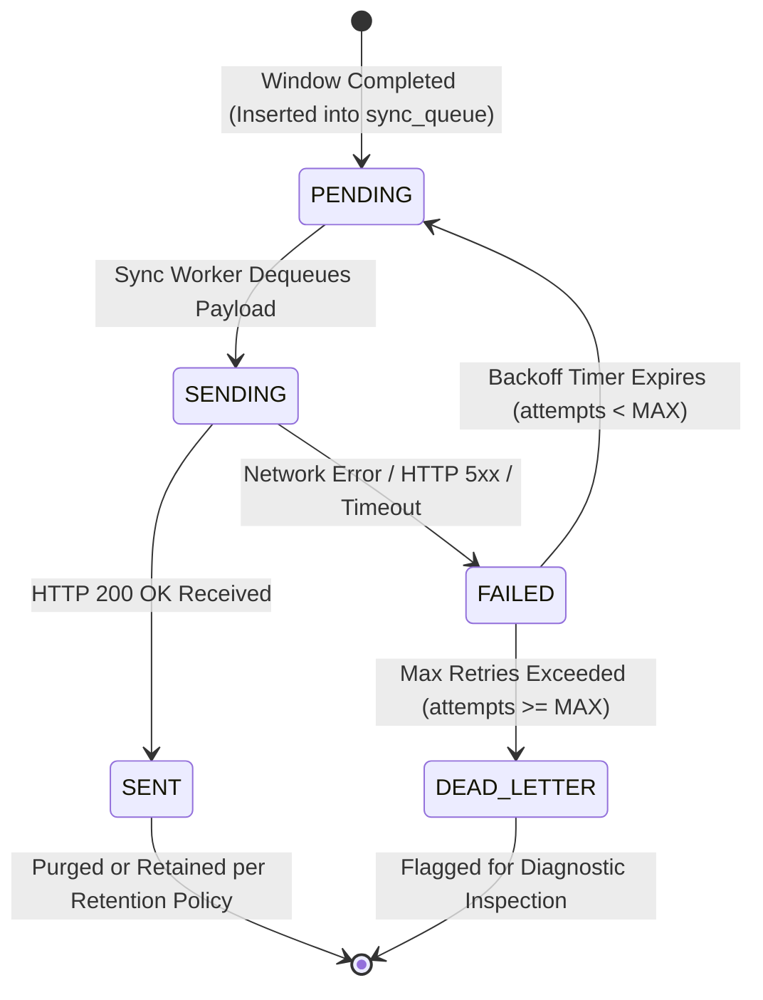

# 08. Offline Operation & Sync

Network partitions, corporate firewall changes, VPN disconnects, and server reboots are standard realities of enterprise IT. EdgeErgo is built offline-first: an Edge Agent operates with complete autonomous functionality even if disconnected from the Central Server for days or weeks.

---

## 1. Offline-First Autonomous Operation

The Edge Agent requires zero network connectivity to execute its core monitoring and alerting responsibilities (PRD §4, §10, §39):

```
+-----------------------------------------------------------------------------+
|                          OFFLINE AUTONOMY SPECTRUM                          |
|                                                                             |
|  CONNECTED STATE                           DISCONNECTED STATE (OFFLINE)     |
|  - Real-time video capture in RAM          - Real-time video capture in RAM |
|  - Pose & Face Mesh landmark tracking      - Pose & Face Mesh tracking      |
|  - RULA & REBA scoring                     - RULA & REBA scoring            |
|  - Desktop overlay alerts & toasts         - Desktop overlay alerts & toasts|
|  - Break & hydration reminders             - Break & hydration reminders    |
|  - Local SQLite persistence                - Local SQLite persistence       |
|  - Immediate telemetry dispatch            - Telemetry buffered in queue    |
+-----------------------------------------------------------------------------+
```

When disconnected from the LAN:
1. **Zero Disruption to Worker**: The camera pipeline, ergonomic analysis, temporal filtering, and PySide6 desktop overlay continue without hesitation.
2. **Local Queue Accumulation**: Telemetry summaries that cannot be delivered are committed to the local `sync_queue` table with status `PENDING`.
3. **Silent Background Retries**: The synchronization worker switches to an exponential backoff schedule, avoiding CPU spin or network hammering.

---

## 2. The `sync_queue` Transaction Lifecycle

Every 5-minute telemetry window follows a strict, transactional state machine managed inside `edgeergo_local.db` (PRD §38, §40):



### State Definitions:
- **`PENDING`**: The window summary is committed locally and awaits network dispatch.
- **`SENDING`**: The sync worker has opened an HTTP connection to `POST /api/v1/telemetry` and is transmitting the payload.
- **`SENT`**: The Central Server acknowledged ingestion with `HTTP 200 OK`. The queue item is completed.
- **`FAILED`**: The network connection timed out, DNS failed to resolve, or the server returned a `5xx Server Error`. The retry counter (`attempts`) increments, and a backoff delay is scheduled.
- **`DEAD_LETTER`**: If a payload encounters unrecoverable client errors (e.g., `422 Unprocessable Entity`), it is quarantined to prevent blocking the remaining queue.

---

## 3. Exponential Backoff & Throttling Strategy

When the Central Server goes offline, dozens of connected Edge Nodes might attempt to reconnect simultaneously upon server restoration. To prevent a "thundering herd" scenario that could crash the server, EdgeErgo enforces randomized exponential backoff with jitter (PRD §40; TECH §4):

### Backoff Mathematical Formulation
The delay $\Delta t_{\text{retry}}$ between successive sync attempts is computed as:
$$\Delta t_{\text{retry}} = \min\left(t_{\text{max}}, t_{\text{base}} \times 2^{\text{attempts}}\right) \pm \text{jitter}$$
- **Base Backoff ($t_{\text{base}}$)**: $5\text{ seconds}$
- **Maximum Backoff Ceiling ($t_{\text{max}}$)**: $300\text{ seconds}$ (5 minutes)
- **Randomized Jitter**: Uniform random variation of $\pm 20\%$ added to the computed interval to desynchronize concurrent node retries.

| Retry Attempt | Base Calculation | Effective Range (with Jitter) | Behavior |
| :---: | :---: | :---: | :--- |
| **1** | $5 \times 2^0 = 5\text{ s}$ | $4.0 - 6.0\text{ s}$ | Fast recovery for transient network hiccups. |
| **2** | $5 \times 2^1 = 10\text{ s}$ | $8.0 - 12.0\text{ s}$ | Short delay. |
| **3** | $5 \times 2^2 = 20\text{ s}$ | $16.0 - 24.0\text{ s}$ | Network partition suspected. |
| **4** | $5 \times 2^3 = 40\text{ s}$ | $32.0 - 48.0\text{ s}$ | Server maintenance or network down. |
| **5** | $5 \times 2^4 = 80\text{ s}$ | $64.0 - 96.0\text{ s}$ | Standard offline interval. |
| **6+** | $5 \times 2^5 = 160\text{ s}$ | $128.0 - 192.0\text{ s}$ | Periodic probe. |
| **Cap** | $\min(300, \dots) = 300\text{ s}$ | $240.0 - 360.0\text{ s}$ | Constant 5-minute health check. |

---

## 4. Idempotency & Deduplication Guarantees

In distributed systems, the classic "network drop after commit" failure occurs when the server receives and writes data, but the network connection breaks before the HTTP acknowledgment returns to the client. The client will naturally resend the payload on its next retry.

EdgeErgo achieves 100% idempotency through cryptographic fingerprinting (PRD §87):

```
                       CANONICAL WINDOW PAYLOAD
  { "node_id": "NODE-001", "window_start": "09:00", "samples": 300, ... }
                                 |
                                 v
                       SHA-256 HASH GENERATOR
                                 |
                                 v
       "a4b89c3f91e704d98342152865e94b29f76a521e8f237b12d590e8c14a9386bc"
                                 |
         +-----------------------+-----------------------+
         |                                               |
         v                                               v
  Client Local Queue                              Central Ingestion Engine
  Stored in sync_queue.window_hash                Checked against UNIQUE constraint
```

### Protocol Invariant:
1. If the Central Server receives a payload whose `window_hash` already exists in `telemetry_summaries`, it executes **zero database writes**.
2. The server responds with `HTTP 200 OK` and payload `{"status": "duplicate_ignored"}`.
3. The Edge Agent treats this `200 OK` as a successful completion, marks the queue record `SENT`, and advances to the next record.

---

## 5. Storage Capacity & Queue Retention Policies

Because telemetry payloads contain only compact text (~1.2 KB per 5-minute window), an Edge Node can remain disconnected for extended durations without exhausting disk space (PRD §38, §40):

### Disconnection Storage Footprint:
- **1 Hour Offline**: 12 windows $\times$ 1.2 KB $\approx$ **14.4 KB**
- **1 Full Workday (8 Hours)**: 96 windows $\approx$ **115.2 KB**
- **1 Full Work Week (5 Days)**: 480 windows $\approx$ **576.0 KB**
- **1 Month Offline**: ~2,000 windows $\approx$ **2.4 MB**

### Queue Retention & Pruning Rules:
- **FIFO Ordered Drain**: When connectivity is restored, the queue flushes in First-In, First-Out (`FIFO`) chronological order, ensuring historical trends reconstruct sequentially on the Central Server.
- **Queue Purge Policy**: Records in `sync_queue` with status `SENT` older than **7 days** are automatically pruned during weekly database vacuum routines to keep `edgeergo_local.db` featherweight (<25 MB).
- **Safety Ceiling**: If the queue exceeds **10,000 pending records** (~35 days of continuous un-synced monitoring), the agent logs an administrative alert and retains the most recent 10,000 records, discarding the oldest pending rows to prevent disk exhaustion.

---

## Related Documents
- [04-edge-agent-workflow.md](file:///c:/Users/georg/EDGE-ERGO%20V3/docs/architecture/04-edge-agent-workflow.md) — Local window synthesis.
- [05-central-server-workflow.md](file:///c:/Users/georg/EDGE-ERGO%20V3/docs/architecture/05-central-server-workflow.md) — Ingestion deduplication.
- [06-data-flow-and-privacy.md](file:///c:/Users/georg/EDGE-ERGO%20V3/docs/architecture/06-data-flow-and-privacy.md) — Telemetry JSON structure.
- [07-data-models.md](file:///c:/Users/georg/EDGE-ERGO%20V3/docs/architecture/07-data-models.md) — `sync_queue` table schema.
